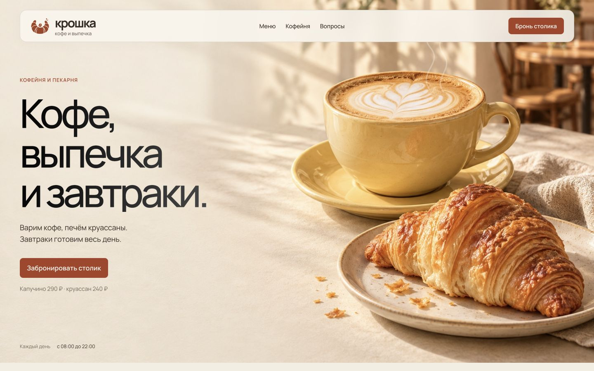

# Крошка · концепт кофейни

Русский лендинг вымышленной кофейни: кофе, выпечка и завтраки. Самостоятельная работа для портфолио. Не связан с действующим заведением.

[Открыть сайт](https://dmitrigabliya.github.io/kroshka-cafe/) · [Репозиторий](https://github.com/dmitrigabliya/kroshka-cafe)



## Посмотреть локально

Из этой папки:

```sh
python3 serve.py
```

Откройте http://127.0.0.1:4173. Для другого порта: `python3 serve.py --port 4175`.

Зависимости и сборка не нужны. Весь сайт находится в `dist/` и работает как статический HTML/CSS/JavaScript. Пути к материалам относительные, поэтому проект можно разместить в подпапке GitHub Pages.

## Что внутри

- Адаптивная композиция, локальный Manrope, оригинальные сгенерированные изображения и новый логотип.
- Первый экран с общей сценой кофе и выпечки, последовательным появлением текста и лёгким паром. Движение останавливается вне экрана и при скрытии вкладки; reduced motion отключает анимацию.
- Меню из 18 позиций: кофе, другие напитки, выпечка и завтраки. Поиск, категории и управление с клавиатуры.
- Карточки блюд: состав, особенности и аллергены, размер порции, ккал, кДж, белки, жиры и углеводы на порцию или на 100 г/мл.
- Выбор объёма, молока и кофе без кофеина; пересчёт цены и примерной пищевой ценности.
- Демонстрационный поднос с количеством, удалением позиций и общей суммой. Заказ никуда не отправляется.
- Появление разделов при прокрутке; поддержка reduced motion.
- Мобильное полноэкранное меню, доступные диалоги и видимый фокус.
- Демобронирование с выбором даты, времени, гостей и типа места, проверкой данных, подтверждением и отменой.
- Брендированная страница 404, описание проекта и конфиденциальности.

Форма и поднос **не отправляют данные**, не принимают оплату и не создают настоящий заказ или бронь. Данные хранятся только в памяти страницы и исчезают после перезагрузки. Нет аналитики, cookies или браузерного хранилища. В демонстрации используется московское время. Пищевая ценность и рецепты вымышлены для концепта; это примерные данные, а не сведения реального заведения.

## Структура

```text
dist/             готовый статический сайт
  assets/         изображения, шрифт, лицензия шрифта, favicon
  index.html      лендинг
  styles.css      адаптивный визуальный стиль
  app.js          интерактивные сценарии
  menu.js         каталог, карточки, питание и поднос
  menu.css        оформление интерактивного меню
  scene.css       композиция и движение первого экрана
  privacy.html    поведение демосайта и данных
  terms.html      информация о концепте
  404.html        страница ошибки
docs/             описание концепта, источники и проверка
serve.py          локальный сервер с брендированной 404
```

Дизайн выполнен с `landing-page-design` из [elayadesign/ai-design-skills](https://github.com/elayadesign/ai-design-skills). Его полный `SKILL.md` скопирован в `AGENTS.md` этой папки и корня рабочего проекта. Источники и промпты фотографий: [docs/ASSETS.md](docs/ASSETS.md). Логотип: [docs/LOGO-V2.md](docs/LOGO-V2.md). Новая утренняя сцена: [docs/HERO-V6-ASSET.md](docs/HERO-V6-ASSET.md).

## Проверка

```sh
python3 scripts/check_site.py
node --check dist/app.js
node --check dist/menu.js
```

Проверка файлов ищет недостающие изображения, шрифты и страницы, сломанные внутренние ссылки и повторяющиеся идентификаторы. Результаты проверки интерфейса в браузере находятся в `docs/QA.md`.

## Публикация на GitHub Pages

Подготовлен workflow `.github/workflows/pages.yml`: после обновления ветки `main` он запускает проверки и публикует только содержимое `dist/`. В настройках Pages нужно выбрать GitHub Actions. Индексация выключена, потому что это концепт вымышленной кофейни. Правила конфиденциальности описывают работу демосайта и технические запросы к GitHub Pages.

Проверки и состояние развёртывания доступны на вкладке Actions репозитория. Изменения документации не запускают повторную публикацию; изменения сайта, скриптов проверки или workflow запускают её автоматически.
